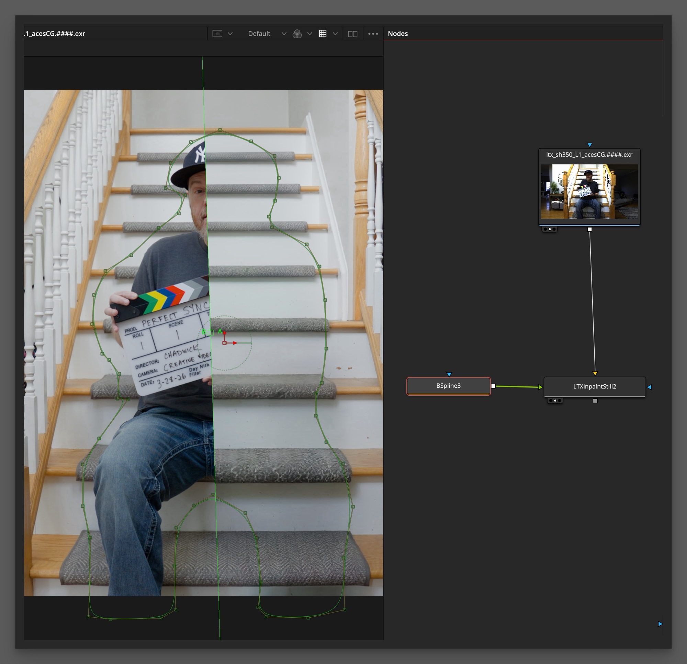
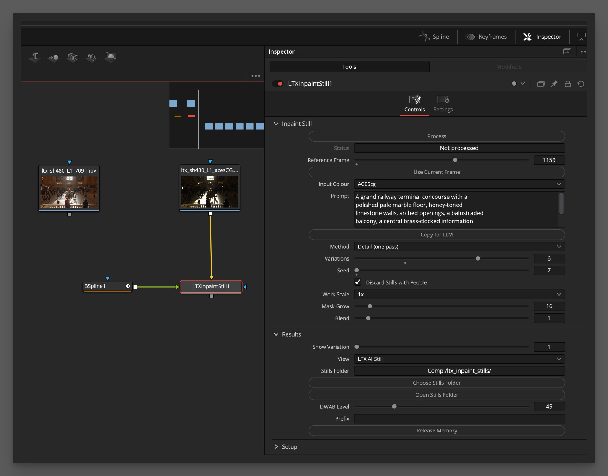

# LTX Inpaint Still for Fusion

**AI clean plates in Fusion, on your Mac.** An OFX plugin for Fusion Studio and DaVinci Resolve's Fusion page that makes clean plate stills with Lightricks' LTX-2.5 and its in/outpainting LoRA. You track, match-move and grade the still yourself. It works in Rec.709 or scene-linear ACEScg, and it can extend a picture onto a bigger canvas too.

From [Creative Video Tips](https://creativevideotips.com), created by Chadwick. This is an independent tool, not made or endorsed by Lightricks or Blackmagic Design. It includes open source code; see [NOTICE](src/NOTICE).

## Download

### [Download the installer: LTXInpaintStill-1.29.pkg](https://github.com/creativevideotips/cvt-ltx-inpaint-still/releases/download/v1.29/LTXInpaintStill-1.29.pkg)

### [Download the guide (PDF)](https://github.com/creativevideotips/cvt-ltx-inpaint-still/releases/download/v1.29/LTX_Inpaint_Still_Guide.pdf)

### [Download the outpainting macro](https://github.com/creativevideotips/cvt-ltx-inpaint-still/releases/download/v1.29/cvt_LTXOutpaintCanvas.setting)



## Is it for you?

- **It makes stills, not video.** You get one frame at a time, ready to track and match-move through your shot. It suits locked-off shots and surfaces that hold still.
- **Fusion only.** Fusion Studio or Resolve's Fusion page. It doesn't work on the Edit or Color pages.
- **Mac with Apple Silicon only.** There is no Windows, Linux or NVIDIA version.
- **macOS 15 (Sequoia) or later.** The installer will not install on an older macOS.
- **128 GB of RAM recommended; not recommended on 64 GB or less.** One HD still reserves about 46 GB in Rec.709 and about 56 GB in ACEScg, and on a 64 GB Mac macOS leaves less than the model needs.
- **About 80 GB of disk space** for the models, or about 125 GB on M1 and M2 Macs, where Setup adds a faster copy of the main model.
- **It needs Apple's Command Line Tools,** a free download from Apple. You don't need to install Python: Setup brings its own.

## Install

1. Quit Resolve and Fusion Studio, then double-click the pkg. It asks for your admin password and installs into `/Library/OFX/Plugins`.
2. Start Fusion. The node is under Effects > OpenFX > Creative Video Tips > LTX Inpaint Still.

## Setup: download the models

The installer is only the plugin. The models come from Hugging Face, and Lightricks asks each person to accept their terms, so you need a free Hugging Face account.

First, install Apple's Command Line Tools if you don't have them:

```bash
xcode-select --install
```

Then, in the node's **Setup** section:

1. Press **View Licence** and tick **I Accept**. The models are under the LTX-2.x Community License, free below USD 10M annual revenue.
2. Press **LTX-2.5 Model Page** and **In/Outpainting LoRA Page**. Log in and accept the terms on both.
3. Press **Token Page** and create a **Read** token.
4. Paste the token into **Hugging Face Token** and press **Download**.

The token is used for that download and never stored. Every file is checked against a pinned checksum.

**Already have LTX Alpha Gen?** This node uses the same models and runtime, so it only downloads the LoRA, about 1.3 GB. **Already have the files elsewhere,** such as in a ComfyUI folder? Put that folder in **Existing Models** and they're reused instead of downloaded. Tick **Link Existing Models** to link to them instead of copying them, which saves up to 73 GB, as long as that folder stays available.

## Using it

1. Connect your picture to the **yellow** input and a mask to the **green** input. White is the area to fill.
2. Set **Input Colour**: **As Is (Rec.709, faster)**, **ACEScg** or **Linear sRGB**. Convert log footage with a CST first.
3. Go to the frame you want and press **Process**. Progress and Cancel appear in their own window.
4. Each still is saved to **Stills Folder** and loaded back on its own Loader. **Show Variation** picks which still the node shows.



### Getting a good fill

- **Describe the scene in Prompt on big holes.** Say what should be there, not what to remove: "A wooden staircase with grey carpet treads in a bright home". Leave out words like "no", "without" or "remove", and don't mention what you're removing. On small holes a prompt makes little difference, so try it blank first.
- **Copy for LLM** writes a prompt with any LLM: it copies instructions and shows the frame with the area to fill in grey, for you to paste in. An online LLM receives that frame, so check that's allowed for your footage.
- **Don't let a mask cut through a person.** The model tends to finish them.
- **Paint easy areas first.** Open sky is best painted in Fusion, with the mask covering only the hard part.
- **Method:** Detail (one pass) has the most detail. Structure (two pass) is softer but safer on very big holes.
- **Work Scale:** small crops need 2x or 4x.
- **Discard Stills with People** is on by default. Any still with a person in the filled area is thrown away and the next seed tried. It can miss a partial head, so still look at your stills.

### ACEScg and highlights

Choose **ACEScg** or **Linear sRGB** and the stills come back in that space, with real values above 1.0 in the fill. Beyond the fade around the fill, every pixel is your original.

**HDR takes longer than Rec.709:** about 72 seconds a still against 52 on an M5 Max at HD.

### Alpha

Each still carries the filled area, your mask plus Mask Grow, in its alpha channel. The colour stays the whole picture, not premultiplied, so you can see the full plate. When you composite, treat it as straight: turn on Post-Multiply on the Loader, or set the Merge to match.

### Outpainting

Add the `cvt_LTXOutpaintCanvas` macro to Fusion's Macros folder and restart. Put it after your image and connect it to the yellow input, leaving green empty: its alpha is the mask. Set the canvas size, then the picture's size, filter and position.

## Speed

Measured on an M5 Max with 128 GB, HD, ACEScg:

| Variations | First run (new prompt, model not loaded) | Model still loaded |
|---|---|---|
| 1 | about 2:15 | about 1:15 |
| 3 | about 4:40 | about 3:40 |
| 6 | about 8:00 | about 7:15 |

Only the 6-variation first run was timed whole; the others are worked out from it. The model stays loaded for 5 minutes after a job, and **Release Memory** unloads it right away.

## What's where

| | |
|---|---|
| Models and runtime | Model Folder, `~/LTX-2.5` by default |
| Stills in progress, encoded prompts, Copy for LLM pictures | Cache Folder |
| Logs and helpers | `~/.cache/ltx-inpaint-still` |
| Settings | `~/.config/ltx-inpaint-still/config.conf` |

**Collect Logs** in Setup writes a support bundle to your home folder, with no pictures and no token. Review it before sending it to anyone.

## Licences

The plugin is open source under the [Mozilla Public License 2.0](LICENSE); third-party notices are in [NOTICE](src/NOTICE). The models are not part of this repository. Each user downloads them under the LTX-2.x Community License.

To build it from source, see `build.sh` and `install.sh`.
